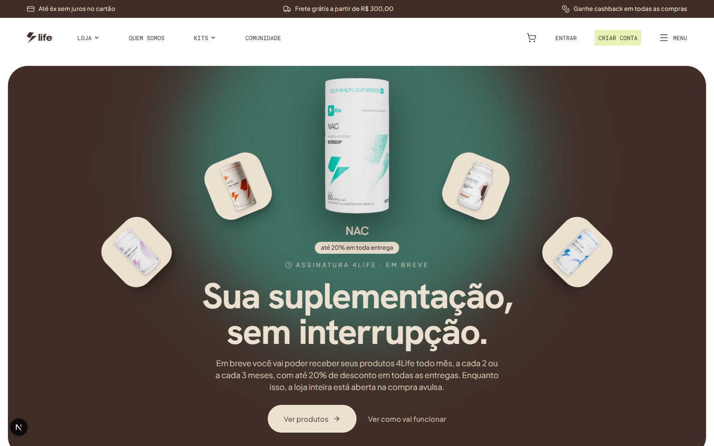
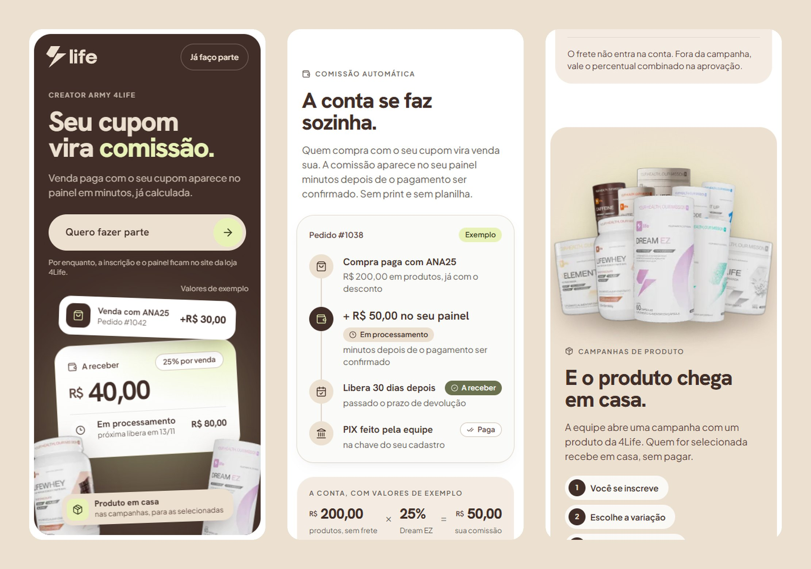

# 4Life Nutrition

**Your Health, Our Mission.** Suplementos e vitaminas de Guarapari (ES) para quem cuida
de saúde, estética e performance.

A 4Life tem duas plataformas próprias, cada uma com repositório, domínio, banco e deploy
separados.

| | Loja | Creator Army |
|---|---|---|
| Para quem | quem compra | creators e a equipe do programa |
| O que faz | catálogo por objetivo, assinatura, checkout com PIX, boleto e cartão, frete cotado na hora, nota fiscal automática | inscrição com fila de aprovação, cupom próprio, extrato de comissão, campanhas de envio de produto |
| Onde | [4lifenutrition.com.br](https://4lifenutrition.com.br) | [creator.4lifenutrition.com.br](https://creator.4lifenutrition.com.br) |

O código das duas é privado.

## Loja

E-commerce próprio, que substituiu a plataforma alugada em 2026: Next.js na frente e
Medusa v2 no back, com Postgres. Pagamento, frete e nota fiscal são integrações diretas,
sem plugin de terceiros no meio.

  
  

  

A assinatura recorrente vem aí: receber os produtos todo mês, a cada 2 ou 3 meses, com
desconto em todas as entregas, e um painel para pular, pausar ou cancelar.

  

## Creator Army

O programa de creators da 4Life. A pessoa se inscreve, alguém da equipe avalia, e quem
entra ganha um cupom próprio e um portal com cada venda e a comissão dela. Nasceu como
módulo da loja e, desde outubro de 2026, tem domínio próprio:
[creator.4lifenutrition.com.br](https://creator.4lifenutrition.com.br).

  

  

## Contato

[Instagram @4lifenutrition_](https://instagram.com/4lifenutrition_) ·
atendimento@4lifenutrition.com.br
